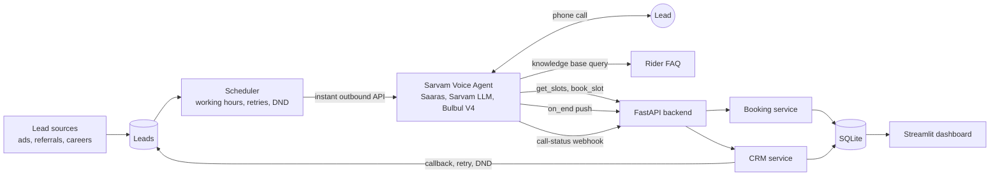
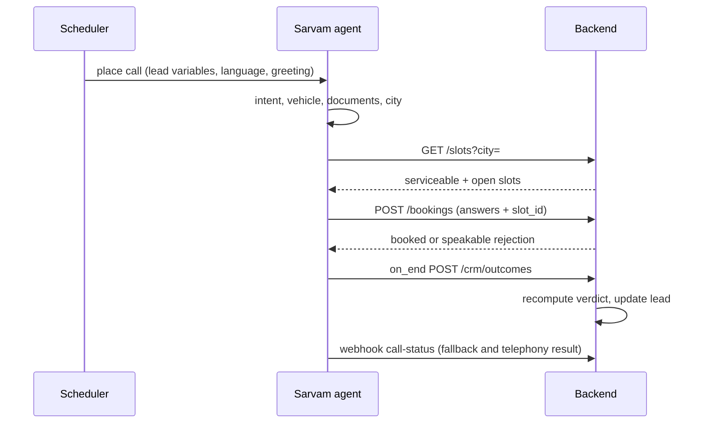

# Architecture

## Call lifecycle

## Where each rule lives

| Concern | Owner | Why |
| --- | --- | --- |
| Conversation, language, tone | Sarvam agent | What LLMs do well |
| Qualified or not | `qualification.py` | Identical answers always give the same verdict |
| Slot capacity, no double booking | `booking.py` | Atomic update; idempotent per `interaction_id` |
| Final outcome | `crm.py` | Agent claim is recorded but never trusted |
| Who to call, when | `scheduler.py`, `schedule.py` | Working hours, retries, call-back windows |
| Never call again | `dnd.py` | Checked before every dial |

## Failure handling

- Unanswered, busy or failed calls: retry after the back-off, clamped to working hours, up to the attempt cap, then the lead is marked exhausted.
- Webhook never arrives: leads stuck in `dialing` are re-queued after 30 minutes.
- Duplicate webhooks or CRM pushes: ignored, so attempts are never double counted.
- Backend or tool error mid-call: the agent apologises and records `follow_up_needed`.
